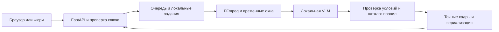

# План реализации assar до 21 часа

**Актуализация 17.10.2026:** ниже сохранён исходный план, его сроки и распределение
больше не задают текущие задания. Один Codex у Анияра ведёт весь продукт
(frontend/backend/общие файлы/deployment) в `codex/integration-cpu`; один ML-Claude
Омара — `app/inference/**`, `tests/inference/**` в `codex/ml`. Прежние отдельные
frontend/backend/GPU-чаты не являются параллельными владельцами. См.
[карту веток](BRANCH_MAP.md), [финальный план](01_CURRENT_STATE_AND_FINISH_PLAN.md),
[запуск](MVP_LAUNCH.md) и [приёмку](MVP_ACCEPTANCE.md). Новую модель, readiness
или правило не принимать только по дате коммита; нужен handoff и фактические проверки.

Цель — работающий локальный сервис на RTX 3060 6 ГБ, доступный через публичный UI и API, **17 октября 2026 к 21:00 по Астане**. После этого — проверка и подготовка питча. Внешний дедлайн — 18 октября 12:00. Время ниже — контрольные точки команды; если начало смещается, сокращать эксперименты, сохраняя интеграцию и проверку публикации.

## Актуализация стартовой основы по ML handoff

Прочитан точный ML-коммит ca336d8c7caa8a7191eea6dd4aeba244f0799191 (base c9f8dda) через git show, без merge. Фактический baseline — локальный llama-server b11669, Qwen3-VL-2B GGUF Q8_0 + mmproj Q8_0; параметры и хеши в configs/model.yaml, миграция в docs/ML_HANDOFF.md. Torch/transformers для интеграции не нужны. Следующие разделы с кандидатами/квантизацией отражают исходный план; параметры фактического baseline берутся из закреплённого config. analyze_video ещё должен реализовать Омар. Backend supervisor владеет отдельным сервером модели и worker, закрывает admission на время остановки/восстановления; один worker kill недостаточен. GPU/скачивание сейчас не выполняются. Распределение ролей не изменилось.

Split v1 сохранён без перераспределения: обе копии X-4/X-47 только в dev, проверка похожих сцен pending. Уже сообщённый Омаром технический benchmark этой dev-группы не доказывает качество и не заменяет независимую оценку test.

## Выбор подхода

Сначала построить baseline без обучения: компактная предобученная мультимодальная модель локально выделяет видимые события в последовательностях кадров; проверяемые условия и фиксированный каталог связывают события с правилами; программа выдаёт реальные кадры и их время. Сравнить результат на групповой development-выборке. Дообучение на сервере — отдельный эксперимент после появления рабочего baseline.

Одна классификация всего видео не решает задачи локализации и нескольких событий. Один кадр часто не устанавливает порядок действий. Обучение с нуля на 40 роликах не является разумным первым шагом. Не строить большой RAG, агентную сеть внутри runtime или сложный трекер до установления реальных классов и ошибок baseline.

### Модели

| Кандидат | Роль | Решение |
|---|---|---|
| Qwen/Qwen3-VL-2B-Instruct | Первый компактный VLM baseline | Официальная карточка указывает Apache 2.0; проверить локальную 4-bit загрузку, видео/мультикадры, скорость и качество |
| HuggingFaceTB/SmolVLM2-2.2B-Instruct | Один резервный VLM | Apache 2.0, предназначена в том числе для видео; сравнивать при провале основного варианта, не разворачивать обе ветки бесконечно |
| Qwen2.5-VL-3B-Instruct и её AWQ | Исключить из стандартного плана | LICENSE указывает non-commercial research и отдельное разрешение для коммерческого применения; это не подходит под требование кейса без такого разрешения |

Источники: [Qwen3-VL-2B](https://huggingface.co/Qwen/Qwen3-VL-2B-Instruct), [SmolVLM2](https://huggingface.co/HuggingFaceTB/SmolVLM2-2.2B-Instruct), [лицензия Qwen2.5-VL-3B](https://huggingface.co/Qwen/Qwen2.5-VL-3B-Instruct/blob/main/LICENSE). Названия — кандидаты, качество на датасете и совместимость окружения ещё не измерены. Перед скачиванием и упаковкой сохранить LICENSE выбранной ревизии, лицензии runtime и зависимостей. Квантизация не меняет исходную лицензию.

У Анияра RTX 3060 Laptop 6 ГБ, при аудите свободно около 3,9 ГБ; у Омара RTX 3050 4 ГБ и сервер для экспериментов. Предпочтение 2B определяется конечным ноутбуком. Веса FP16, KV-cache и визуальные токены требуют отдельной памяти; «2B» само по себе не гарантирует размещение. Выбранный backend/quantization проверять в реальном окружении. Если WSL уже настроен — можно использовать; переустановка системы и тяжёлого inference-стека не входит в критический путь.

Сервер использовать как управляемый командой сервер для локальных открытых моделей, обучения и экспериментов; не подменять его внешним облачным AI API. Код можно обсуждать с агентами, а ролики, наблюдения и model outputs хранить внутри используемых командой машин. На сервере обучать модель, которая помещается на 3060, либо компактный адаптер к ней. Итоговые веса перенести, заранее загрузить все файлы processor/tokenizer, отключить онлайн-загрузки и повторить проверки на ноутбуке.

### Первый измеримый эксперимент

1. Выделить группы и зафиксировать split до настройки промптов. Выбрать из development 2 положительных и 2 отрицательных примера с разной длительностью, отдельно добавить самый длинный development-ролик. Эталонные ответы остаются только в оценщике.
2. Загрузить одну модель в отдельном локальном процессе. Сначала проверить полный проход на 3060, одновременно с экспериментами на сервере Омара по согласованному расписанию GPU.
3. Измерить время загрузки, пик VRAM, время обработки каждого видео, валидность JSON, число кадров, FP/FN. Содержательные результаты не печатать в облачный чат, отдавать агрегаты.
4. За 60–90 минут принять решение: работает ли baseline в 240-секундном внутреннем бюджете с приемлемыми наблюдениями; перейти на резервный вариант только при конкретной причине. 240 секунд — запас команды, не обещание и не официальный порог.
5. Если VLM не даёт полезных наблюдений, проверить простые локальные детекторы под 1–2 действительно видимые категории из разметки. Такой fallback снижает покрытие и должен быть честно отражён; нельзя заменять работу классификатора постоянным verdict.

## Минимальная архитектура

FastAPI обслуживает API и простые HTML/CSS/JS из `app/web/`. SQLite хранит задания, файлы — в локальных папках по случайному job_id. Отдельный worker владеет GPU и загружает модель один раз. Один worker процесса API для MVP либо явно реализованная межпроцессная очередь; не включать несколько uvicorn workers поверх раздельных очередей в памяти. Redis/Celery не обязательны.

Frontend показывает загрузку, состояние обработки, итог, список событий, кадры, время и источник. Шрифты и библиотеки локальные. Ключ жюри вводится в браузере и хранится в памяти сеанса, а не включается в исходники. Регистрация пользователей не нужна. Нужны понятные сообщения про неверный ключ, некорректное видео и failed.

### Обработка ролика

1. Проверка файла, размерного лимита с запасом к 29 МБ, фактического формата и длительности. Не доверять имени файла. Сохранение в уникальную папку; пути пользователя не исполнять и не передавать shell-строкой.
2. Декодирование FFmpeg с сохранением исходных PTS и корректной ориентации. Равномерные окна покрывают весь ролик; добавочный выбор кадров по движению допускается, но не заменяет покрытие статичных событий.
3. Стартовая гипотеза для замера: окна 8–12 секунд, около 1 кадра/секунду, batch=1, ограниченные visual tokens и 96–160 новых текстовых токенов. На самом длинном ролике это порядка 12–18 окон. Эти параметры менять по измерениям; редкая выборка может пропустить короткое действие.
4. Локальная VLM возвращает наблюдения и номера кадров из известного окна. Вопросы про факты и порядок действий; источники права модель не сочиняет. Ограниченный JSON валидируется программой.
5. Для кандидатов — более частые кадры вокруг события, например 4 FPS в ±2 секунды, с лимитом числа уточняющих окон. Если проблема заключается в порядке действий, передавать временную последовательность, а не одиночный crop. Кропы добавлять только вместе с контекстом и реальной видимостью.
6. Каталог проверенных правил и временные условия решают, хватает ли оснований. Смежные дубли одного события объединять; разные события сохранять. Самооценка confidence от VLM не считается откалиброванной вероятностью.
7. Программа выбирает 1–3 настоящих кадра по PTS, создаёт JPEG и формирует точную схему. Не рисовать и не генерировать доказательства. В description — факт, осторожное обоснование, правило и ссылка.

Весь этап имеет общий deadline. Supervisor должен уметь прервать зависший собственный GPU-worker, отметить job failed и восстановить worker: прекращение ожидания thread/Future не останавливает вычисление на GPU. Ограничить очередь и узнать параллельность запросов жюри: два последовательных задания по 240 секунд не укладываются в 5 минут для второго. До тестирования второго запроса нельзя заявлять поддержку такой нагрузки. Не скрывать перегрузку под no_violation.

## Работа по времени

| Время 17 октября UTC+5 | Анияр | Омар | Проверяемый результат |
|---|---|---|---|
| До 15:30 | Контракт, групповой split, часть человеческого просмотра; публичные нормы через Gemini | Scaffold API с Claude; доступ к серверу, просмотр train/dev, спорные отметки, подтверждение применимости нормативов | Таксономия v1 локально, split зафиксирован, выбран baseline, API-контракт общий |
| 15:30–17:00 | Фронтенд с Argon; тесты контракта и интеграции с Codex; проверка 3060; подготовка внешнего доступа | Backend/очередь и ML baseline с Claude в отдельных чатах/ветках; окно/JSON/кадры; первые dev-ошибки | Отдельно работают API/UI и реальный model adapter; измерены память и время |
| 17:00–18:00 | Интеграция ML, ключ, ошибки, внешний пробный запрос | Устранение ошибок baseline, экспорт компактных весов/конфигурации | Первый полный реальный проход MOV → события → API/UI на 3060 |
| 18:00–19:30 | Стабильность, данные API, smoke-набор, UI-доказательства | Только при готовом baseline: один LoRA/QLoRA-эксперимент на train и выбор по dev | Кандидат подтверждён на 3060; baseline сохранён для отката |
| 19:30 | Зафиксировать модель/конфиг/источники | Передать веса, revision, лицензии, команды | Model freeze; итоговая конфигурация больше не подбирается по закрытой проверке |
| 19:30–20:30 | Закрытая проверка, отключённый интернет для inference, публичный POST/GET с другой сети | Ручная проверка локальных доказательств, исправление критических багов | Реальный сервис доступен, ограничения и метрики записаны |
| 20:30–21:00 | Сборка релиза, runbook, ключ, резервная копия | Документация, сценарий демонстрации, список сдачи | Функциональная готовность к 21:00 |
| После 21:00 | Проверки доступности/надёжности по очереди | Питч и демонстрация по очереди | Только критические исправления; подтверждение срока/канала сдачи |

Если к 17:00 baseline не работает, отказаться от дообучения до появления сквозного результата. Если к 18:00 нет прохода на ноутбуке — все ML-ресурсы на переносимость, а не новый большой checkpoint. Если эксперимент не превосходит baseline на заранее заданных dev-показателях или не помещается в 6 ГБ/бюджет времени — сдаётся baseline. Полная готовность к 21:00 является целью, её нельзя гарантировать до первого benchmark.

## Что делать на сервере

Допустимый эксперимент — адаптация компактного VLM к кратким структурированным наблюдениям и собственным классам на вручную проверенной train-части. По каждой сцене брать временные окна и подтверждённые события; одно видео с десятью окнами всё ещё одна независимая группа. Положительная точка не превращает оставшиеся окна в отрицательные.

Сохранить baseline, фиксированный dev-набор и prompt version до эксперимента. Начать с лёгкого адаптера, ограничить число запусков; сравнить с тем же baseline при одинаковом декодировании. Закрытый test не использовать для early stopping, выбора checkpoint, порогов, промптов или псевдоразметки. Внешний teacher допустим только как локальная открытая модель на сервере; его наблюдения требуют человеческой проверки. Учитель не должен видеть закрытый test.

После обучения перенести адаптер вместе с точной базовой ревизией либо воспроизводимо объединить веса, затем проверить выбранную квантизацию на 3060. Сравнение проводить после квантизации — итоговое качество может отличаться. Сервер не решает проблему покрытия новых категорий и другого ракурса; для них полезнее небольшое число новых разрешённых съёмок с правильными и неправильными действиями, если команда успевает.

## Распределение файлов и ролей

| Направление | Ответственный | Разрешённые файлы | Результат |
|---|---|---|---|
| Координация и релиз | Анияр + основной Codex | `app/contracts.py`, `docs/CONTRACTS.md`, root configs, dependency/lock, `configs/model.yaml`, deploy, `app/rules/catalog.json`, общие test fixtures | Единые интерфейсы, сборка, воспроизводимый запуск |
| Backend | Омар + отдельный чат Claude | `app/api/**`, `app/jobs/**`, `tests/api/**` | Загрузка, очередь, ключ, статусы, сериализация, обработка ошибок |
| ML | Омар + Claude | `app/inference/**`, `tests/inference/**` | Локальный анализ и реальные кадры; train/dev на сервере; перенос на 3060 |
| UI | Анияр + Argon (Gemini Pro) | `app/web/**` | Статический интерфейс по принятому контракту |
| Данные и оценка | Отдельный Codex; Анияр хранит закрытые ответы | `scripts/data/**`, `scripts/eval/**`, `tests/eval/**`, локальные отчёты | Группы, split, метрики, проверки утечки; без передачи наблюдений облачной модели |
| Правила | Анияр + отдельный исследовательский чат Gemini; применимость подтверждает Омар | Сначала текст с открытыми источниками; интегратор вносит проверенное в каталог | Точные действующие правила, ограничения применимости |
| Независимая проверка | Отдельный сеанс Claude/ChatGPT или Codex | Чтение diff и контракта; без самостоятельных изменений | Только конкретные дефекты с воспроизведением |

Сервер принадлежит ML-направлению; на 3060 интегратор выделяет окно для измерения и затем для финального сервиса. Не запускать одновременно две копии модели на одном GPU. RTX 3050 можно использовать для лёгкой отладки, но обещать размещение полной модели в 4 ГБ нельзя.

Подписки распределены так: Codex/ChatGPT Pro и Gemini Pro (Gemini 4 Argon) у Анияра, Claude Pro у Омара. По выбору команды Argon делает фронтенд, Claude помогает Омару с backend и ML в отдельных чатах и рабочих папках. Если доступен только чат без локального агента, передавать контракт и файлы кода, получать полный patch/файлы и применять их в отдельной рабочей папке соответствующей ветки. Анияр применяет результат Argon только в app/web/**; Омар применяет backend- и ML-код Claude в соответствующих областях. Для публичных нормативов и проверки питча Анияр использует отдельный исследовательский чат Gemini. Подключение Argon как coding-agent рассматривается отдельно; до настройки доступ к файлам и терминалу не предполагается. Для такого агента использовать отдельный checkout кода без датасета и приватных результатов. Видео, кадры и описания сцен не передаются ни одному из облачных помощников.

## Git без конфликтов

Подтверждён режим отдельных компьютеров. На старте этой работы чистый `main` указывал на `c9f8ddac82b6ebb832e00a50b64d756c0f8eac97`. Общая основа готовится в `codex/bootstrap`; отдельный data/eval-агент работал в изолированном `.worktrees/data-split`, интегратор принял только его scripts/tests/docs и приватный split. Backend/ML/UI не создавались. Взаимодействие с remote и публикация сервиса не входят в этот стартовый шаг.

Стартовая версия содержит `app/contracts.py`, `app/settings.py`, пустой каталог правил, `configs/model.yaml` со статусом not_configured, общий CPU/API lock и синтетические ответы. Контракт 0.1 сверен с исходным разделом 10 и FAQ. Ветки `codex/backend`, `codex/ml`, `codex/frontend`, `codex/eval` создавать от одного стартового commit по [инструкции](OMAR_START.md). На каждом компьютере свой clone. Если на одном компьютере параллельно пишут два агента — каждому отдельный worktree; разные ветки внутри одной общей папки не обеспечивают изоляцию.

Split v1 реально зафиксирован: 22 train / 8 dev / 10 frozen test уникальных видео, SHA256-копии не пересекаются. Приватный manifest у Анияра, агрегатная квитанция в Git. Подробности и human-review барьер до настройки модели — [DATA_SPLIT.md](DATA_SPLIT.md). Изменений владельцев направлений нет; контракт и ограничения для передачи Омару/Argon изложены в инструкции, сообщения от их имени автоматически не отправляются.

Интегратор один меняет общие зависимости, контракт и main. Не пересоздавать структуры проекта из каждого промпта. Изменение контракта: короткое предложение с причиной и потребителями → решение интегратора → обновление контракта → уведомление направлений. Не требуется заново спрашивать пользователя о каждой обычной реализации внутри принятого плана.

Каждые 60–90 минут передавать маленькую законченную часть. Handoff содержит base commit, файлы, команды, проверки и результаты, ограничения, запрошенные зависимости. Не присылать в облачный чат видеокадры и содержательные логи inference. Ветки не включают data/, веса, токены и тестовые загрузки. Перед merge интегратор читает diff и запускает относящиеся к изменению проверки.

## Проверка качества

Отдельно считать бинарную confusion matrix, precision/recall/F1 и balanced accuracy, показывать абсолютные числа. 21/40 = 52,5% — результат постоянного положительного классификатора, а не полезная цель. На 10 test-видео одна ошибка меняет accuracy на 10 процентных пунктов; не заявлять банковскую точность по такой выборке.

Локализацию оценивать после сопоставления событий: абсолютная ошибка времени и доля попаданий в собственные окна ±1/±3/±5 секунд как диагностические метрики, **не как допуск организаторов**. При ручной интервальной разметке считать пересечение интервалов и проверять релевантность кадров. Без собственной разметки типов нельзя честно посчитать качество классификации. Пример X-4/X-47 проверять с сохранёнными исходными отметками до решения человека.

Дополнительно: macro-F1 типов только при достаточном числе размеченных примеров; доля событий с проверенным источником; реальные времена всех роликов и максимум, холодный/тёплый запуск, пик VRAM; доля валидных ответов, успешность при потере интернета. Указывать размер выборки и не выдавать percentile на нескольких роликах за устойчивую характеристику.

Устойчивость: проверить разрешённые новые съёмки под другим углом, перекрытия и похожие нормальные действия. Кроп, изменение яркости и перспективная деформация — стресс-тесты, но не эквивалент настоящего нового ракурса. Производные одного видео остаются в его split.

После model freeze один раз оценить закрытую часть. Если по результатам изменили модель или пороги, эта часть стала development и больше не является независимой. Критические технические ошибки можно исправлять, повторную оценку явно обозначать.

## Готовность к 21 часу

- Новое MOV с произвольным именем проходит реальный анализ через внешний URL, без ручного запуска inference.
- Оба endpoint соответствуют контракту; неверный ключ отклоняется; `failed` не превращается в no_violation.
- Для события есть тип, корректный таймкод, 1–3 настоящих JPEG, наблюдаемый факт и проверенная ссылка. No_violation имеет пустой список.
- На самом длинном доступном видео итоговый ноутбук укладывается в 300 секунд; очередь/одновременные запросы проверены в согласованном сценарии.
- Веса, processor, tokenizer и web-assets локальны; при заблокированном внешнем inference-доступе сервис продолжает работать. Публичный доступ для проверки проводится отдельным тестом.
- UI/API URL, секретный ключ жюри, инструкция, зависимости, model revision, каталог и лицензии подготовлены. При перезапуске worker задания получают корректное состояние, сервер не засыпает во время проверки.
- Список поддерживаемых типов основан на фактической разметке и измерениях. Ошибки и неразличимые условия описаны честно.

Для 5-минутного питча: 40 секунд проблема; 60 секунд демонстрация; 70 секунд подход и локальность; 60 секунд измерения и доказательства; 40 секунд нормы/ограничения; 30 секунд развитие. Не показывать выдуманные результаты; сценарий демонстрации и резервное локальное видео собственного интерфейса подготовить после работающего релиза.
