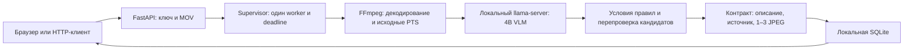

# Техническое описание и границы результата

Технически проверена интеграция ML `bed499b8c15365981571bb2215097b28c46adc4f`.
[Отчёт и ограничения](../ACCEPTANCE_6CA5_3060.md). Production пока не опубликован.

Supervisor владеет worker и llama-server, повторно использует их между заданиями
и завершает собственное дерево при timeout/сбое. Во время recovery приём закрыт.
Один HTTP worker без reload. Бюджеты: полный запрос 300 s, анализ 240 s,
отдельное обращение к модели не более 120 s и остатка общего deadline.
Пропуск обязательной проверки без подтверждённого события даёт failed;
подтверждённое событие допускается с предупреждением о неполном анализе.

## Модель и окружение

- Qwen3-VL-4B-Instruct-GGUF Q4_K_M; vision projector Q8_0.
- llama.cpp b11669, Windows CUDA runtime; Python 3.11, FastAPI/Uvicorn,
  FFmpeg N-122697-gfcfb33922f-20260210.
- prompt `cash-specialists-v6`, max_tokens=500; ctx=8192, image_max_tokens=256,
  n_gpu_layers=99, parallel=1, temperature=0, top_k=1, seed=0, cache_prompt=false.
- Выборка 1 s, окна 10 s. Сначала отдельные проходы признаков людей и ценностей,
  затем условия правил; MULTI-01 требует дополнительной перепроверки трёх кадров.
- Точные model/base revisions, SHA256 GGUF/mmproj/runtime и параметры находятся
  в `configs/model.yaml` репозитория. Веса и runtime в Git не включены.
- Проверено на RTX 3060 Laptop 6144 MiB. Максимальное полное время реального
  задания 121.657 s; максимальный снятый показатель VRAM всего GPU 5781 MiB.
  Это не гарантия для произвольных файлов/оборудования и не непрерывный замер пика.

## Заявленное покрытие

| Правило | Возможный признак | Обязательная оговорка |
|---|---|---|
| MULTI-01 | Несколько людей кроме кассира внутри помещения при кассире на месте, подтверждение на трёх разных кадрах | Источник **не устанавливает прямого запрета на присутствие нескольких клиентов**. Роли, параллельное обслуживание и незавершённость предыдущей операции требуют проверки человеком. |
| CASH-03 | Отсутствие кассира при наблюдаемых ценностях на столе | По видео не доказаны факт ранее состоявшегося приёма, содержимое сумки и статус операции. Это возможный признак, не окончательная юридическая квалификация. |

Источник — Правила № 231 от 29.11.2019, пп. 20 и 22:
https://adilet.zan.kz/rus/docs/V1900019680 . Применение этих двух кандидатов
подтвердил Омар; точные формулировки, контекст, исключения и дата проверки —
`app/rules/catalog.json` и [ACCEPTED_RULES_V6.md](../ACCEPTED_RULES_V6.md).
Обычная передача или открытие сумки сами по себе отдельным нарушением не считаются.
Ключи, сейфы, пересчёт, подлинность, проводки, полномочия и умысел не заявлены покрытыми.

## Ограничения и данные

Модель ошибается в наблюдениях; дискретная выборка пропускает короткие действия.
Основной dev: TP=1/FN=2/FP=0/TN=4/failed=0. Diagnostic отдельно: TP=1/failed=0.
По разбору Омара оба FN относятся к непокрытым типам; в общей метрике они сохранены.
Полные агрегаты и смысл проверок — [README.md](README.md). Это не независимая test-оценка.
Неверная длительность контейнера может исключить хвост при декодировании;
поддержка произвольного повреждённого MOV не заявлена.

Inference и обработка видео выполняются на компьютере команды. Внешние LLM/VLM
не используются; звук и идентификация лиц не анализируются. После подготовки
зависимостей и весов runtime не требует скачивания. Это не новая квитанция теста
с физически отключённой сетью. Внешний HTTPS-туннель при публикации служит транспортом
и проходит через провайдера, поэтому его нельзя описывать как полностью локальный
сетевой маршрут. Сейчас production не опубликован.

Временные файлы job удаляются, результат/JPEG сохраняются локально в SQLite.
Ключ находится у команды и проверяющих; общий ключ не даёт изоляции разных
пользователей по job_id. Нельзя публиковать ключ, результаты и банковские материалы.
Исходные 40 групп разделены train/dev/frozen-test 22/8/10; копии одной группы не
разделяются. Диагностическая группа только dev. Frozen test в этом проходе не использован.

## Происхождение и лицензии

Это сведения из локальных поставок/metadata, не обещание одинаковых условий у
других сборок. Бинарники не перераспространяются этим пакетом.

| Компонент | Зафиксированное основание |
|---|---|
| Qwen3-VL-4B-Instruct | `BASE_MODEL_CARD.md` выбранной ревизии указывает Apache-2.0; модель: https://huggingface.co/Qwen/Qwen3-VL-4B-Instruct |
| GGUF/mmproj | Закреплённые артефакты официального Qwen-репозитория: https://huggingface.co/Qwen/Qwen3-VL-4B-Instruct-GGUF |
| llama.cpp | Локальный LICENSE: MIT, ggml authors; https://github.com/ggml-org/llama.cpp |
| Установленный FFmpeg | `ffmpeg -L`: GPL version 3 or later; это конкретная сборка с --enable-gpl/--enable-version3 |
| Python-зависимости | Полный version lock, metadata и доступные LICENSE/NOTICE в архиве |
| CUDA / NVIDIA / ngrok | Отдельные внешние поставки; в архив не включены, не объявляются лицензированными MIT/Apache |

Репозиторий команды: https://github.com/Aniyear/assar-datathon . Отдельная лицензия
на собственный код проекта в корне пока не объявлена; нельзя обещать третьим лицам
произвольное коммерческое переиспользование всего проекта. Если нужен передаваемый
комплект бинарников, лицензионное сопровождение этой поставки проверяется отдельно.
